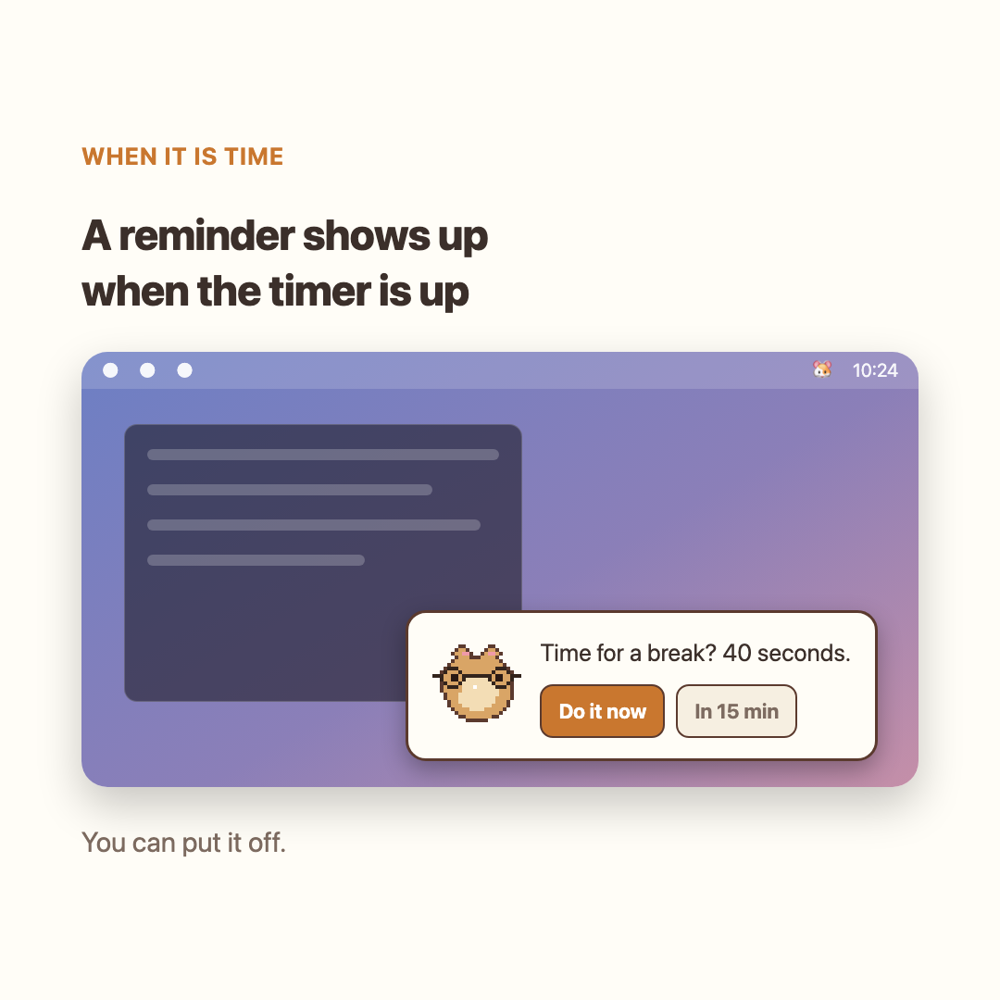
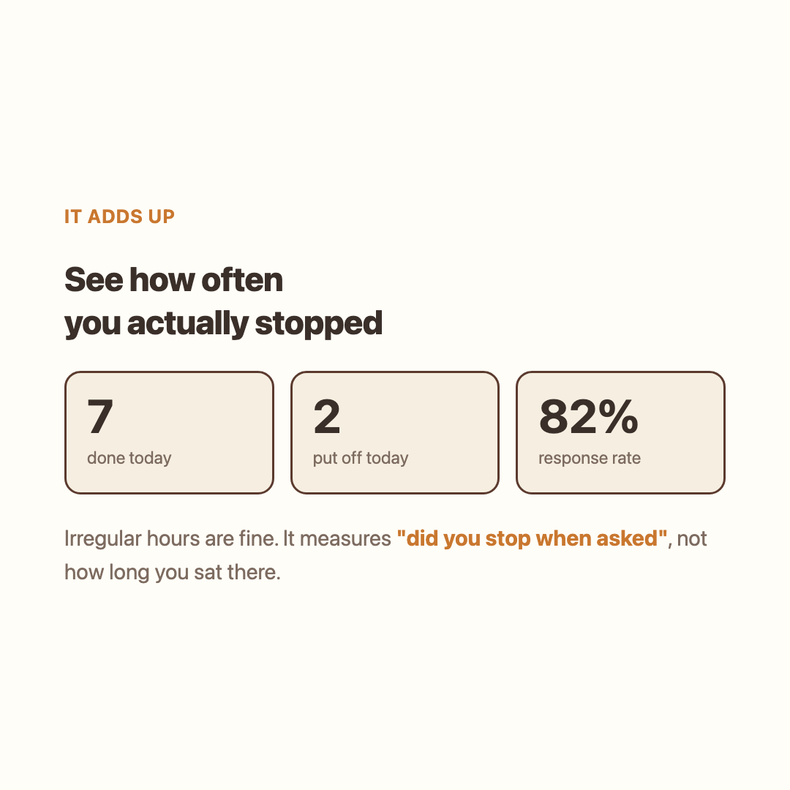

<p align="center">
  <a href="README.md"></a>
  <a href="README.ko.md"></a>
</p>

<p align="center">
  
</p>

<p align="center">A menu bar app with reminders for eye breaks and stretching.</p>
<p align="center">Follow a hamster around the screen and stretch with it. Snooze when you’re busy.</p>
<p align="center">3.9MB · 0.43% idle CPU · online only to check for updates · free</p>

---

When you spend hours at a computer, it is easy to forget to rest your eyes or move.
If you are looking for eye care reminders, desk stretches when you notice tech neck,
or regular breaks from sitting for your back health, Hamstretch can remind you to pause.

Every 20 minutes, a hamster invites you to take a break: follow it with your eyes,
look away at something distant, then stretch together.

## How it works

A break reminder appears in a corner of your screen every 20 minutes. You can start
a break or snooze for 15 minutes.

During a break, the hamster runs around the screen edge and stretches. Its cheek
pouches and a weekly log show how often you snoozed.

## A 40-second break

| | |
|---|---|
| 20s | The hamster runs two laps around the screen edge. Follow it with your eyes. |
| 10s | Look away from the screen, out a window or at something far away. |
| 10s | Stretch. |

<p>
  
  
</p>

## Install

Get it from the [download page](https://ganggangstone.github.io/hamstretch/).

On macOS, move the app to Applications and right-click → Open. It's unsigned, so a plain
double-click gets blocked, and this is needed once per new version. On Windows (beta),
run the installer; if SmartScreen appears, click "More info → Run anyway".

Or with Homebrew:

```bash
brew install --cask ganggangstone/tap/hamstretch
```

Use `brew upgrade` for new versions without the right-click step.

## Usage records

Breaks and snoozes are recorded locally on your computer and are not sent to a server.
The app connects to GitHub once a day to check for a new version.

## Decisions made while building it

[DECISIONS.md](DECISIONS.md) explains implementation choices and the alternatives
considered. Starred entries mark changes to the idle CPU threshold and weekly goal
based on measurements.

This repository contains the landing page, release files, and decision log.
The app source is maintained separately.
